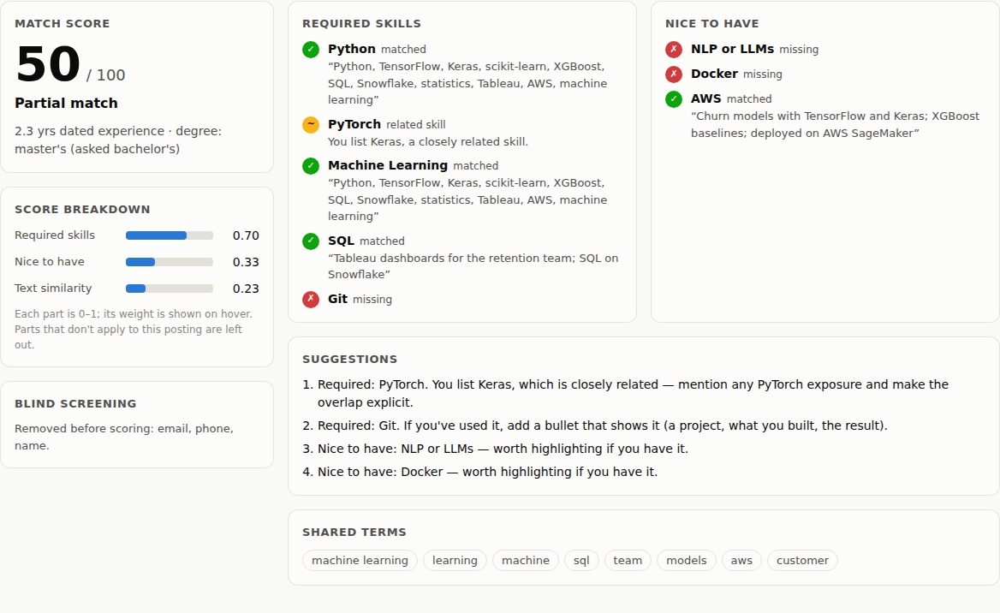

# Resume–Job Matcher

**Explainable resume ↔ job matching: a score you can argue with, and advice you can act on.**

[](https://github.com/Krishna-44/resume-job-matcher/actions/workflows/ci.yml)


[](LICENSE)

<picture>
  <source media="(prefers-color-scheme: dark)" srcset="docs/screenshot-dark.png">
  
</picture>

Most resume screeners output a single opaque number. This one shows its work: for every requirement
in a job post it says whether the resume **meets it**, **partly meets it** through a related skill
(MySQL for PostgreSQL, Keras for PyTorch), or **misses it** — quoting the resume line that counts
as evidence — and turns the gaps into concrete suggestions.

It's useful from both sides of the table: candidates can see how a resume reads against a posting
and what to fix; recruiters can rank applicants and see *why* each one ranks where they do.

## Features

- **Skill extraction with a curated taxonomy** — 115 skills with aliases ("k8s" → Kubernetes,
  "sklearn" → scikit-learn) and word-boundary rules that cope with `C++`, `C#`, `.NET`, `Node.js`
  and `CI/CD`, while ignoring ordinary words: "react quickly", "excel at", "the rest of the team",
  "Spring 2023", "R&D" and "go-to" are *not* skills (all covered by tests).
- **Related-skill partial credit** through 19 skill families (SQL databases, deep-learning
  frameworks, clouds, CI tools, …).
- **Job-post parsing** — required vs. nice-to-have sections, alternatives ("Python or R",
  "Tableau / Power BI"), minimum years, and the lowest degree named.
- **Experience from dates** — employment ranges (`Jan 2021 – Present`, `06/2020 - 08/2021`,
  `2019 – 2022`) with overlapping roles merged; study dates don't count as work.
- **Blind screening** — names, emails, phone numbers, profile URLs and personal attributes (date of
  birth, age, gender, marital status, nationality, religion) are removed *before* scoring. A test
  proves the score is identical when they change.
- **Ranking and gap analysis** — rank applicants for a job, rank jobs for a candidate, and find the
  skills missing across several target jobs (a learning plan, most-needed first).
- **CLI, REST API and web UI**, with `.txt` and `.pdf` resume upload.

## How the score works

| Component | Weight | Meaning |
|---|---:|---|
| Required skills | 0.45 | Share of required skills shown; half credit for a related skill |
| Nice-to-have skills | 0.15 | The same for preferred skills |
| Text similarity | 0.25 | TF-IDF cosine similarity of the two documents (saturates at 0.35) |
| Experience | 0.15 | Dated experience ÷ years asked for, **scaled by required-skill coverage** |

Components that don't apply (no preferred skills, no years asked) are dropped and the rest
re-weighted, so short postings aren't penalised. Scaling experience by skill coverage means years
only count when they're relevant: a mechanical engineer's five years don't satisfy "3+ years of
DevOps". Bands: **Strong** ≥ 75, **Good** ≥ 55, **Partial** ≥ 35, else **Weak**.

## Quick start

```bash
git clone https://github.com/Krishna-44/resume-job-matcher.git
cd resume-job-matcher
python -m venv .venv && source .venv/bin/activate
pip install -e ".[dev,pdf]"

jobmatch serve        # web UI at http://127.0.0.1:8000, API docs at /docs
```

From the command line (the sample files are in `src/jobmatch/samples/`):

```text
$ cd src/jobmatch/samples
$ jobmatch match resumes/data_scientist.txt jobs/ml_engineer_intern.txt

50/100 — Partial match

  required skills   ██████████████       0.70  (weight 0.53)
  preferred skills  ███████              0.33  (weight 0.18)
  text similarity   ████                 0.22  (weight 0.29)

Required skills
  ✓ Python  — “Python, TensorFlow, Keras, scikit-learn, XGBoost, SQL, Snowflake, statistics, Tableau, AWS, machine learning”
  ~ PyTorch (via Keras)
  ✓ Machine Learning  — “Python, TensorFlow, Keras, scikit-learn, XGBoost, SQL, Snowflake, statistics, Tableau, AWS, machine learning”
  ✓ SQL  — “Tableau dashboards for the retention team; SQL on Snowflake”
  ✗ Git
  ...
Suggestions
  • Required: PyTorch. You list Keras, which is closely related — mention any PyTorch exposure and make the overlap explicit.
  • Required: Git. If you've used it, add a bullet that shows it (a project, what you built, the result).

$ jobmatch rank --job jobs/backend_engineer.txt resumes
 1.  94.7  Strong match   backend_java
 2.  28.7  Weak match     devops_engineer   missing: Java, Spring Boot, PostgreSQL, REST APIs, Microservices
 ...

$ jobmatch gaps resumes/ml_student.txt jobs
REST APIs                    needed by 3/6 jobs
React                        needed by 2/6 jobs
Kubernetes                   needed by 2/6 jobs (you have Docker, related)
...
```

**Docker:** `docker build -t resume-matcher . && docker run -p 8000:8000 resume-matcher`

## Evaluation

The bundled set has 8 fictional resumes and 6 job posts. Each of the 48 pairs was labelled
*before the scorer was written* (0 = not a fit, 1 = partial, 2 = strong), by judging whether the
person would be worth interviewing. For each job the 8 resumes are ranked and compared with the
labels (`jobmatch eval`):

| Method | NDCG@3 | Top-1 hit rate | Spearman ρ |
|---|---:|---:|---:|
| jobmatch (full score) | 0.964 | 1.00 | 0.795 |
| TF-IDF similarity only | 0.949 | 1.00 | 0.775 |
| skill overlap (Jaccard) | 0.985 | 1.00 | 0.800 |

**What this shows — and doesn't:**

- Every method puts a strong candidate first for every job. With one clear fit per role, this set
  is too easy and too small (48 pairs) to separate the methods; the differences are within a pair
  or two of rankings. A plain skill-overlap baseline is as good here, which is worth knowing.
- The full score's value is what the baselines can't give: per-requirement evidence, partial credit,
  alternatives, relevant experience and actionable suggestions — and a number that doesn't move when
  a name or email changes.
- **One change was made after the first evaluation run:** experience is now scaled by required-skill
  coverage (ρ was 0.756 before). It fixed a real flaw — unrelated years counted fully — rather than
  fitting the labels. No weights were tuned on this set.
- A larger, independently labelled dataset is the most important next step before trusting the
  score for real decisions.

## Responsible use

Automated screening can encode bias and reject good candidates for wording. This project removes
personal attributes before scoring and explains every decision, but it is a **decision-support
tool**: a person should review the evidence, especially for "Partial" and "Weak" matches. Degree
requirements are shown but not scored, because "or equivalent experience" is common and degrees are
a known proxy for socioeconomic background.

## API

| Method | Path | Description |
|---|---|---|
| `POST` | `/api/match` | `{resume, job}` → score, components, skill evidence, suggestions |
| `POST` | `/api/rank-resumes` | `{job, resumes: {id: text}}` → candidates, best first |
| `POST` | `/api/rank-jobs` | `{resume, jobs: {id: text}}` → jobs, best fit first |
| `POST` | `/api/skill-gaps` | `{resume, jobs}` → missing skills across jobs, most needed first |
| `POST` | `/api/extract` | `{text, kind: resume\|job}` → parsed skills, years, degree / requirements |
| `POST` | `/api/resume-text` | Upload `.txt` or `.pdf` → plain text |

## Project structure

```text
src/jobmatch/
├── taxonomy.py    115 skills, aliases, families, boundary-aware matching
├── pii.py         blind-screening redaction
├── extract.py     sections, skills + evidence, dated experience, degrees, job requirements
├── scoring.py     explainable score, partial credit, suggestions
├── ranking.py     rank resumes / jobs, skill-gap analysis
├── evaluation.py  NDCG@3, top-1, Spearman vs. baselines on the labelled set
├── api.py, cli.py, static/   REST API, `jobmatch` command, web UI
└── samples/       fictional resumes, job posts and relevance labels
tests/             42 tests
```

## Testing

```bash
pytest -q       # 42 tests, ~3 s
ruff check .
jobmatch eval
```

Tests cover alias matching and false-positive words, experience-date arithmetic (including merged
overlaps and ignoring study dates), degree parsing ("MS Office" is not a master's), job-post
alternatives, redaction of every sample resume, score invariance to personal details, explanations,
ranking, gap analysis, the API and a quality floor on the evaluation set.

## Roadmap

- [ ] A larger labelled dataset, ideally with multiple annotators and agreement statistics
- [ ] Sentence-embedding similarity behind the same interface as TF-IDF
- [ ] Learning the component weights from labelled data (with a held-out test split)
- [ ] Skill taxonomy as a data file so teams can extend it without code changes

## License

[MIT](LICENSE) © Krishna Goyal
